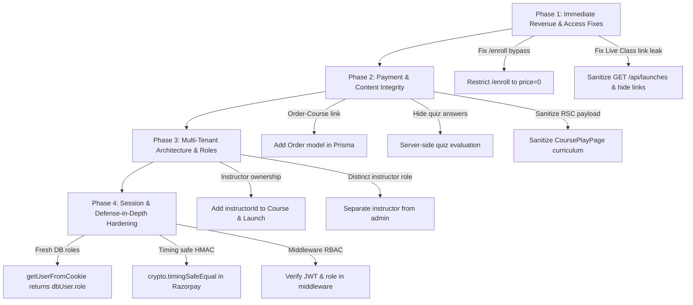

# GoLiveClasses LMS — Role-Based Access Control (RBAC) & Permissions Audit Report

**Audit Target:** GoLiveClasses LMS  
**Branch:** `redesign/warm-editorial`  
**Commit:** `3381aca29f82155809b15120a161703a0dd55871`  
**Mode:** Read-Only Security & Permissions Audit  
**Auditor:** Antigravity AI (Gemini Pro)  
**Date:** October 12, 2026

---

## 1. Executive Summary

A comprehensive, evidence-based permissions audit was conducted across the entire GoLiveClasses LMS codebase, encompassing the Prisma data models, authentication architecture, routing middleware, all 31 Next.js App Router API route handlers, React server and client components, AWS S3 storage integrations, and Razorpay payment flows.

### Bottom-Line Verdict: **NOT SAFE FOR PRODUCTION**

While the application features well-designed core defenses (e.g. rate limiting on authentication routes, bcrypt password hashing, sha256 OTP hashing, S3 MIME/size validation, and user-scoped isolation for notes and progress records), **critical authorization vulnerabilities exist that permit complete bypass of course payments, unauthorized entry into live sessions, and significant proprietary curriculum/quiz data leakage**:

1. **Free Course Enrollment Bypass (`POST /api/courses/[id]/enroll`)**: Any authenticated student can directly call this endpoint to enroll in any course of any price completely free of charge. No payment verification or order check exists on the route.
2. **Public Live Session Link Exposure (`GET /api/launches` & `/live-classes`)**: Unauthenticated guests can fetch the full database record of live sessions, including confidential meeting URLs (`link`), and join live classes without registration or enrollment.
3. **Curriculum & Quiz Answer Leakage via Next.js RSC Flight Payload (`/courses/[id]/play`)**: When an unauthenticated student accesses a free preview lecture, the server passes the raw, unsanitized `Course` object to the client component. The Next.js RSC flight payload in the page source exposes the complete syllabus, lecture content, and all quiz questions with `correctAnswerIndex` in plaintext.
4. **Decoupled Payment Verification (`POST /api/checkout/razorpay/verify`)**: Payment signature verification does not cross-check the Razorpay order ID against a server-side Order model or the requested `courseId`. A user can purchase a cheap course and verify it against an expensive course ID.
5. **Architectural Absence of Course & Session Ownership**: The `Course` and `UpcomingLaunch` Prisma models have no `instructorId` foreign key. There is no instructor ownership boundary; all instructors are granted global `admin` access and can edit, unpublish, or delete each other's courses and sessions.

---

## 2. Actual User Roles and Definitions

Investigation of `prisma/schema.prisma`, `src/lib/auth.ts`, `src/app/api/auth/**`, and UI components reveals the following:

| Role Identifier | Storage Model | UI Display Name | Description & Capabilities |
|---|---|---|---|
| **Guest / Anonymous** | None (`token === null`) | Visitor | Can browse home, catalogue, course overviews, legal terms, and login/register. Can view scheduled live sessions. |
| **Student** | `User.role === 'student'` (String) | Scholar | Default role upon registration and Google OAuth. Can view `/my-learning`, track lecture progress, save notes, post discussions, add to wishlist, view profile, and play purchased courses / free previews. |
| **Instructor / Faculty** | `User.role === 'admin'` (String) | Faculty / Teacher | **There is no separate `instructor` role in the database.** In `src/app/login/page.tsx`, the UI presents a "Teacher" selector that maps directly to `admin` in the backend. Instructors hold full administrative privileges. |
| **Admin** | `User.role === 'admin'` (String) | Faculty / Admin | Can access `/admin/*`, create/edit/delete any course, create/edit/delete categories, upload assets to S3, manage live launches, and view platform-wide analytics and revenue. |
| **Superadmin** | `User.role === 'superadmin'` (String) | Provost & Executive Console | Holds all admin privileges plus `/superadmin/*`. Can view scholar registry (`/superadmin/users`), block/unblock accounts, delete users, and modify platform settings (`/superadmin/settings`). |

### Role Tampering Analysis
- **Signup (`POST /api/auth/register`)**: Hardcodes `const role = 'student'`. Client-supplied role parameter is discarded.
- **Profile Setup (`POST /api/auth/profile-setup`)**: Whitelists phone, headline, bio, github, linkedin, avatar. Cannot alter role.
- **User Update API (`PUT /api/users/[id]`)**: Restricted to `superadmin`; only permits updating `isBlocked`. There is no API route to modify roles.
- **Conclusion**: A user **cannot** accidentally or maliciously change their own role through signup, profile updates, or API requests.

---

## 3. Master Role-Permissions Matrix

| Feature / Action | Guest | Student (Unenrolled) | Student (Enrolled) | Admin (Faculty) | Superadmin |
|---|---|---|---|---|---|
| **Public Access** | | | | | |
| View home page & legal docs | Allow | Allow | Allow | Allow | Allow |
| Browse catalogue & course overview | Allow | Allow | Allow | Allow | Allow |
| View course price & syllabus titles | Allow | Allow | Allow | Allow | Allow |
| Register, verify email, log in | Allow | Allow | Allow | Allow | Allow |
| Forgot password & reset password | Allow | Allow | Allow | Allow | Allow |
| **Student Learning Features** | | | | | |
| View student dashboard (`/my-learning`) | Deny | Allow | Allow | Allow | Allow |
| Access purchased course player | Deny | Deny | Allow | Allow | Allow |
| Play paid lectures | Deny | Deny | Allow | Allow | Allow |
| Play free preview lecture (Lecture 1) | Deny (Redirects to login) | Allow | Allow | Allow | Allow |
| View quiz questions | Deny | Conditional (Lec 1 leaked) | Allow | Allow | Allow |
| View quiz answers in client payload | Deny | Conditional (Lec 1 leaked) | Allow (Plaintext) | Allow | Allow |
| Submit quiz & view results | Deny | Conditional (Lec 1 only) | Allow | Allow | Allow |
| Track course progress (`/api/progress`) | Deny | Deny | Allow | Allow | Allow |
| Create video notes (`/api/courses/[id]/notes`) | Deny | Allow (Unverified enroll) | Allow | Allow | Allow |
| Post course discussions / replies | Deny | Allow (Unverified enroll) | Allow | Allow | Allow |
| Submit course review | Deny | Deny | Conditional (>50% done) | Conditional | Conditional |
| View own profile, wishlist, invoices | Deny | Allow | Allow | Allow | Allow |
| Access another student's progress or notes | Deny | Deny | Deny | Deny | Deny |
| Download academic certificate | Deny | Deny | Conditional (100% done) | Conditional | Conditional |
| **Instructor / Faculty Features** | | | | | |
| Access faculty console (`/admin/*`) | Deny | Deny | Deny | Allow | Allow |
| Create new course (`POST /api/courses`) | Deny | Deny | Deny | Allow | Allow |
| Edit/publish/delete any course | Deny | Deny | Deny | Allow | Allow |
| Upload video/thumbnail assets to AWS S3 | Deny | Deny | Deny | Allow | Allow |
| Restrict course editing to course creator | Deny | Deny | Deny | Deny (No ownership) | Deny (No ownership) |
| Manage live launches (`/admin/launches`) | Deny | Deny | Deny | Allow | Allow |
| View platform revenue analytics | Deny | Deny | Deny | Allow | Allow |
| **Superadmin Operations** | | | | | |
| Access `/superadmin/*` | Deny | Deny | Deny | Deny | Allow |
| View user registry (`GET /api/users`) | Deny | Deny | Deny | Deny | Allow |
| Suspend/Unsuspend users (`PUT /api/users/[id]`) | Deny | Deny | Deny | Deny | Allow |
| Expel/Delete users (`DELETE /api/users/[id]`) | Deny | Deny | Deny | Deny | Allow |
| Edit global platform settings | Deny | Deny | Deny | Deny | Allow |
| Create category (`POST /api/categories`) | Deny | Deny | Deny | Allow | Deny (Bug in route) |
| **Sensitive & Security Features** | | | | | |
| Access private S3 objects directly | Deny | Deny | Deny | Deny | Deny |
| Request S3 presigned video playback URL | Deny | Conditional (Lec 1 only) | Allow (1-hr token) | Allow | Allow |
| Call free enrollment bypass endpoint | Deny | Allow (Critical Flaw) | Allow | Allow | Allow |
| Intercept live session meeting link | Allow (Critical Flaw) | Allow | Allow | Allow | Allow |
| Immediate session revocation on demotion | Deny (Stale 7d JWT) | Deny | Deny | Deny | Deny |
| Immediate session revocation on block | Allow | Allow | Allow | Allow | Allow |

---

## 4. Complete API Endpoint Authorization Inventory

| HTTP Method & Path | Purpose | Authentication | Allowed Roles | Ownership Checks | Enrollment Checks | Input Validation | Data Exposure | Result |
|---|---|---|---|---|---|---|---|---|
| `POST /api/auth/register` | Register new student | Public | Public | N/A | N/A | Strict regex, string casting | User email | Pass |
| `POST /api/auth/login` | Authenticate user & issue JWT | Public | Public | N/A | N/A | Validated | Role & auth cookie | Pass |
| `POST /api/auth/logout` | Clear auth cookie | Public | Any | N/A | N/A | None | None | Conditional (JWT not blacklisted) |
| `GET /api/auth/me` | Fetch active session | Optional | Any | User bound | N/A | None | Session user object | Pass |
| `POST /api/auth/verify` | Verify email OTP | Public | Public | User bound | N/A | Validated 6-digit | Auth cookie & role | Pass |
| `POST /api/auth/resend` | Resend verification OTP | Public | Public | N/A | N/A | Validated | Discloses user presence | Fail (Enumeration) |
| `POST /api/auth/forgot-password` | Generate reset token | Public | Public | N/A | N/A | Validated | Generic message | Pass |
| `POST /api/auth/reset-password` | Set new password | Public | Public | Token bound | N/A | Validated length >= 6 | None | Pass |
| `GET /api/auth/google/login` | Start OAuth handshake | Public | Public | N/A | N/A | State cookie | None | Pass |
| `GET /api/auth/google/callback` | Finalize Google OAuth | Public | Public | N/A | N/A | State verified | Auth cookie | Pass |
| `POST /api/auth/profile-setup` | Update scholar profile | Required | Any authenticated | User bound | N/A | Extension check on avatar | Updated user | Pass |
| `GET /api/courses` | List catalogue | Optional | Public (published); Staff (all) | N/A | N/A | Admin query param | Course list | Pass |
| `POST /api/courses` | Create new course | Required | `admin`, `superadmin` | None | N/A | No schema validation | Created course | Pass |
| `GET /api/courses/[id]` | Get course curriculum | Optional | Public (sanitized); Enrolled/Staff (full) | Yes (Purchased check) | Yes | None | Leaks Lec 1 quiz answers & content | Conditional |
| `PUT /api/courses/[id]` | Update course | Required | `admin`, `superadmin` | None (No creator relation) | N/A | None | Updated course | Pass |
| `DELETE /api/courses/[id]` | Delete course | Required | `admin`, `superadmin` | None (No creator relation) | N/A | None | None | Pass |
| `POST /api/courses/[id]/enroll` | Enroll in course | Required | Any authenticated | User bound | **NONE (No payment check)** | None | Enrollment confirmation | **FAIL (CRITICAL)** |
| `GET /api/courses/[id]/video-url` | Presigned S3 video URL | Required | Enrolled student, Staff, Lec 1 preview | N/A | Yes | Validated lectureId | 1-hr presigned S3 URL | Pass |
| `GET /api/courses/[id]/reviews` | Fetch course reviews | Public | Public | N/A | N/A | None | Public reviews | Pass |
| `POST /api/courses/[id]/reviews` | Post course review | Required | Enrolled student (>50% complete) | User bound | Yes | Rating 1-5, comment text | Created review | Pass |
| `GET /api/courses/[id]/notes` | Get lecture notes | Required | Authenticated user | User bound (`userId`) | **No** | None | User's notes | Pass |
| `POST /api/courses/[id]/notes` | Save lecture note | Required | Authenticated user | User bound (`userId`) | **No** | Required fields | Created note | Pass |
| `DELETE /api/courses/[id]/notes` | Delete lecture note | Required | Authenticated user | User bound (`userId`) | N/A | None | None | Pass |
| `GET /api/courses/[id]/discussions` | Get discussions | Public | Public | N/A | N/A | None | Public threads & replies | Pass |
| `POST /api/courses/[id]/discussions` | Post discussion/reply | Required | Authenticated user | User bound (`userId`) | **No** | Required fields | Discussion record | Pass |
| `GET /api/progress` | Fetch course progress | Required | Authenticated user | User bound (`userId`) | N/A | None | User progress | Pass |
| `POST /api/progress` | Save lecture progress | Required | Enrolled student | User bound (`userId`) | Yes | Required fields | Updated progress | Pass |
| `POST /api/checkout/razorpay/create-order` | Create order | Required | Authenticated user | User bound | N/A | Validated courseId | Razorpay order (paise) | Pass |
| `POST /api/checkout/razorpay/verify` | Verify payment | Required | Authenticated user | User bound | N/A | HMAC signature verified | Enrollment confirmation | **FAIL (HIGH - Decoupled order)** |
| `POST /api/upload` | Upload asset / get presigned upload URL | Required | `admin`, `superadmin` | N/A | N/A | MIME & size strictly validated | S3 URL & key | Pass |
| `GET /api/launches` | List live sessions | Optional | Public (scheduled/live); Staff (all) | N/A | N/A | None | **Leaks meeting link (`link`)** | **FAIL (HIGH)** |
| `POST /api/launches` | Schedule live launch | Required | `admin`, `superadmin` | None | N/A | None | Created launch | Pass |
| `PUT /api/launches/[id]` | Update live launch | Required | `admin`, `superadmin` | None | N/A | None | Updated launch | Pass |
| `DELETE /api/launches/[id]` | Delete live launch | Required | `admin`, `superadmin` | None | N/A | None | None | Pass |
| `GET /api/categories` | List categories | Public | Public | N/A | N/A | None | Category list | Pass |
| `POST /api/categories` | Create category | Required | `admin` only | N/A | N/A | None | Created category | Fail (Rejects `superadmin`) |
| `GET /api/user/wishlist` | Get wishlist | Required | Authenticated user | User bound | N/A | None | Wishlist courses | Pass |
| `POST /api/user/wishlist` | Toggle wishlist | Required | Authenticated user | User bound | N/A | Validated courseId | Updated wishlist | Pass |
| `GET /api/users` | List scholars | Required | `superadmin` only | N/A | N/A | Excludes superadmins | User registry (safe fields) | Pass |
| `PUT /api/users/[id]` | Block/unblock scholar | Required | `superadmin` only | N/A | N/A | Validated isBlocked | Updated user | Pass |
| `DELETE /api/users/[id]` | Expel scholar | Required | `superadmin` only | N/A | N/A | None | None | Pass |
| `GET /api/settings` | Get platform settings | Required | `superadmin` only | N/A | N/A | None | Platform settings | Pass |
| `POST /api/settings` | Save platform settings | Required | `superadmin` only | N/A | N/A | None (Mass assignment) | Updated settings | Conditional |
| `GET /api/analytics` | Fetch analytics | Required | Student (own); Staff (all) | Scoped by role | N/A | None | Platform revenue to all admins | Conditional |
| `GET /api/recommendations` | Get course suggestions | Optional | Public / Authenticated | User bound if logged in | N/A | None | Suggested courses | Pass |

---

## 5. Live-Class Permissions Report

1. **Guest Access**:
   - Guests can access `/live-classes` without authentication.
   - When any session is in `live` status, the direct join URL (`featuredLive.link`) is rendered as an open `<a>` link on the page.
   - Calling `GET /api/launches` returns all live session objects including `link` in unauthenticated JSON responses.
2. **Student Permissions**:
   - Students cannot create, start, or edit live sessions (blocked by server checks requiring `admin` or `superadmin`).
   - Students can join **any** live session if the meeting link is published. There are no enrollment gates or cohort validations.
3. **Instructor Permissions & Ownership**:
   - Instructors (holding `admin` role) can create, update, and delete live sessions.
   - However, the `UpcomingLaunch` model contains only a textual `instructorName: String`. It has **no `instructorId` foreign key**. Any admin can edit or delete any live session created by another instructor.
4. **Meeting URL & Credential Leakage**:
   - The meeting URL (`link`) is stored in plaintext in PostgreSQL and returned unconditionally to public callers.

---

## 6. Course Ownership and Student Access Report

1. **Absence of Instructor Ownership**:
   - In `prisma/schema.prisma`, `Course` has no `instructorId`, `creatorId`, or `authorId`.
   - All courses belong globally to the platform. Any user with role `admin` can edit, rename, change prices of, or delete any course.
2. **Student Access to Paid Content**:
   - While `GET /api/courses/[id]/video-url` correctly verifies `isEnrolled` for lectures 2..N, the vulnerability in `POST /api/courses/[id]/enroll` allows any student to grant themselves enrollment.
3. **Next.js RSC Flight Payload Exposure**:
   - In `src/app/courses/[id]/play/page.tsx` line 144, `<CoursePlayerClient course={course} ... />` receives the unsanitized `course` model. When an unenrolled user loads lecture 1 (free preview), Next.js serializes all sections, paid lecture titles, lecture descriptions, quiz questions, and quiz answers into the page's HTML flight stream.
4. **Client-Side Quiz Answer Exposure**:
   - `QuizPlayer.tsx` receives `quizData.questions` which includes `correctAnswerIndex: number`. Quiz evaluation is executed purely on the client side (`selectedAnswer === question.correctAnswerIndex`). Answers are completely exposed to anyone inspecting the page.

---

## 7. Payment and Enrollment Security Report

1. **Price Integrity**:
   - In `POST /api/checkout/razorpay/create-order`, the price is read directly from `course.price` on the server and converted to paise (`Math.round(course.price * 100)`). The client cannot dictate the order amount.
2. **Order-to-Course Decoupling in Verification**:
   - In `POST /api/checkout/razorpay/verify`, the endpoint checks `generated_signature !== razorpay_signature`.
   - However, the server does **not** store an `Order` model in PostgreSQL and does **not** query Razorpay's API to confirm that `razorpay_order_id` belongs to the `courseId` submitted in the request body. A malicious user could complete a ₹1 test order and verify it against a ₹49,999 course ID.
3. **Direct Enrollment Bypass**:
   - `POST /api/courses/[id]/enroll` calls `CourseRepository.addPurchase(user.id, courseId)` with zero payment validation.

---

## 8. AWS S3 and Video Permissions Report

1. **Upload Permissions**:
   - Restricted strictly to `admin` and `superadmin` in `src/app/api/upload/route.ts` (Line 9).
   - Server-side MIME type validation and file size limits are enforced.
   - S3 keys are generated with `crypto.randomUUID()`, preventing arbitrary file overwrite.
   - AWS access keys and secret keys never reach the client.
2. **Video Playback URLs**:
   - `GET /api/courses/[id]/video-url` issues presigned URLs with 3600-second (1-hour) expiration.
   - Direct S3 bucket access is blocked by private bucket ACL / bucket policies.
   - The video player applies dynamic canvas watermarking with the student's email as deterrence against screen recording.

---

## 9. Authentication, Logout, and Session Security Report

1. **Cookie Configuration**:
   - Cookie `auth-token` is set with `httpOnly: true`, `secure: true` (in production), and `path: '/'`.
   - `sameSite` is not explicitly declared (defaults to browser Lax).
   - In `src/app/api/auth/verify/route.ts`, `maxAge` is omitted (creating a session cookie), whereas `login` specifies `7 days`.
2. **Stateless JWT Limitations**:
   - Tokens are valid for 7 days.
   - Logout deletes the client cookie but does not invalidate the JWT server-side.
   - Password reset updates the hash and clears the reset token, but does not revoke existing JWTs.
3. **Immediate Revocation vs Stale Roles**:
   - `isBlocked` is checked against the database in `getUserFromCookie()`, ensuring immediate account suspension upon being blocked by an administrator.
   - However, `getUserFromCookie()` returns `decoded` (which includes `decoded.role` embedded at login). If an admin's role is demoted in the database, the active JWT retains admin permissions for up to 7 days.
4. **Rate Limiting**:
   - Active memory-based rate limiting is present on login (10/min), registration (5/min), verification (10/min), resend (3/min), and password reset (3-5/min).

---

## 10. Prioritized Security Findings

### [CRITICAL] 1. Direct Free Enrollment API Bypass
- **File & Lines:** `src/app/api/courses/[id]/enroll/route.ts#L7-L36`
- **Expected:** Course enrollment must only be granted upon verified payment receipt or if `course.price === 0`.
- **Actual:** Any authenticated user can call `POST /api/courses/[id]/enroll` to enroll in any course for free.
- **Impact:** Complete bypass of paywall; loss of platform revenue.
- **Recommended Fix:** Delete this route or restrict it strictly to free courses (`course.price === 0`). Paid courses must only be enrolled through `checkout/razorpay/verify`.

### [CRITICAL] 2. Unauthenticated Live Session Link Exposure
- **File & Lines:** `src/app/api/launches/route.ts#L24-L28` & `src/app/live-classes/page.tsx#L69-L93`
- **Expected:** Meeting links (`link`) must be concealed from public APIs and only revealed to authenticated, enrolled students.
- **Actual:** `GET /api/launches` and `/live-classes` render the active meeting link to anonymous visitors with no authentication or cohort check.
- **Impact:** Video meeting disruption, unauthorized attendance, leakage of premium live classes.
- **Recommended Fix:** Exclude `link` from public queries (`select: { id: true, title: true, ... }`). Create a protected join endpoint `POST /api/launches/[id]/join` that verifies authentication and enrollment before returning the meeting link.

### [HIGH] 3. Full Syllabus & Paid Assets Leaked via Next.js RSC Flight Payload
- **File & Lines:** `src/app/courses/[id]/play/page.tsx#L19` & `L144`
- **Expected:** Only previewable lecture data should be passed to client components for non-enrolled students.
- **Actual:** The raw `course` object containing the full curriculum JSON is passed into `<CoursePlayerClient course={course} ... />`, which serializes the entire paid syllabus, quiz answers, and lesson content into the HTML flight stream.
- **Impact:** Proprietary course content and video keys accessible via View Page Source.
- **Recommended Fix:** Sanitize `course.curriculum` in `CoursePlayPage` prior to passing it as a prop to `CoursePlayerClient`.

### [HIGH] 4. Plaintext Quiz Answers in Client Payloads
- **File & Lines:** `src/components/QuizPlayer.tsx#L7-L11` & `src/app/api/courses/[id]/route.ts#L102-L120`
- **Expected:** Quiz answer keys should remain on the server; client submits answers for server evaluation.
- **Actual:** `quizData.questions` contains `correctAnswerIndex` in plaintext. The browser performs answer matching.
- **Impact:** Academic assessment integrity compromised; answers easily extracted from browser state.
- **Recommended Fix:** Strip `correctAnswerIndex` before sending questions to the client. Evaluate answers via a dedicated `POST /api/courses/[id]/quizzes/[lectureId]/submit` endpoint.

### [HIGH] 5. Decoupled Payment Verification Allowing Course Substitution
- **File & Lines:** `src/app/api/checkout/razorpay/verify/route.ts#L9-L45`
- **Expected:** Verify that the Razorpay order ID matches the specific course ID and amount paid.
- **Actual:** Signature is verified, but order ID is not linked to `courseId` on the server.
- **Impact:** A student can purchase a low-cost course and submit the verified payment signature with an expensive course ID.
- **Recommended Fix:** Create an `Order` model in Prisma storing `userId`, `courseId`, `amount`, and `status`. Verify the order record and update status upon signature verification.

### [HIGH] 6. Missing Instructor Course & Session Ownership
- **File & Lines:** `prisma/schema.prisma#L52-L73` & `src/app/api/courses/[id]/route.ts#L8-L36`
- **Expected:** Instructors should only be capable of editing or deleting their own courses and live sessions.
- **Actual:** No `instructorId` foreign key exists on `Course` or `UpcomingLaunch`. All instructors are `admin`s with global write access across all courses.
- **Impact:** Cross-instructor data tampering or accidental deletion of courses and sessions.
- **Recommended Fix:** Add `instructorId String` to `Course` and `UpcomingLaunch` in Prisma schema. Enforce `course.instructorId === user.userId` in course mutation routes.

### [MEDIUM] 7. Stale JWT Role Persistence & Lack of Server-Side Session Revocation
- **File & Lines:** `src/lib/auth.ts#L18-L26` & `src/app/api/auth/logout/route.ts#L5-L9`
- **Expected:** Role revocations and logouts take immediate effect.
- **Actual:** JWTs are stateless for 7 days. `getUserFromCookie()` returns `decoded.role` instead of `dbUser.role`.
- **Impact:** Demoted administrators retain administrative access until token expiry.
- **Recommended Fix:** In `getUserFromCookie()`, return `dbUser.role` rather than `decoded.role`. Maintain a `tokenVersion` or session table to invalidate tokens on logout/password reset.

### [MEDIUM] 8. Inconsistent Middleware Protection
- **File & Lines:** `src/middleware.ts#L5-L21`
- **Expected:** Middleware should check JWT validity and role requirements for `/admin` and `/superadmin`.
- **Actual:** Only checks whether the cookie exists. Students pass middleware and rely solely on layout redirects.
- **Impact:** Weakened defense-in-depth perimeter.
- **Recommended Fix:** Validate token signature and role in middleware.

### [LOW] 9. Superadmin Excluded from Category Creation
- **File & Lines:** `src/app/api/categories/route.ts#L20`
- **Expected:** Superadmin has all admin privileges.
- **Actual:** `user.role !== 'admin'` rejects `superadmin`.
- **Impact:** Superadmin cannot create categories via API.
- **Recommended Fix:** Update condition to `user.role !== 'admin' && user.role !== 'superadmin'`.

### [LOW] 10. Missing Timing-Safe Comparison on Razorpay Signature
- **File & Lines:** `src/app/api/checkout/razorpay/verify/route.ts#L32`
- **Expected:** Use `crypto.timingSafeEqual`.
- **Actual:** Uses string inequality `!==`.
- **Impact:** Theoretical timing attack against HMAC.
- **Recommended Fix:** Use `crypto.timingSafeEqual(Buffer.from(generated), Buffer.from(signature))`.

---

## 11. Unverified Areas & Tests That Could Not Safely Run

Under strict read-only audit constraints, the following tests were not executed to protect the database and live infrastructure:
1. **Live Payment Gateway Execution**: Razorpay test order creation and webhook receipt were not triggered with live gateway calls.
2. **Database Mutation Invalidation**: No test users, fake orders, or role modifications were written to the PostgreSQL database.
3. **AWS S3 Object Deletion**: Presigned deletion operations were not tested to prevent accidental deletion of existing S3 assets.

---

## 12. Recommended Remediation Plan (Prioritized)

### Phase 1 — Immediate Pre-Production Fixes (Critical)
1. **Remove or Protect `/api/courses/[id]/enroll`**:
   - Check `if (course.price > 0) return NextResponse.json({ error: 'Payment required' }, { status: 402 })`.
2. **Secure Live Session Meeting Links**:
   - Modify `src/app/api/launches/route.ts` to omit `link` in public queries.
   - Implement a gated `POST /api/launches/[id]/join` endpoint that verifies authentication and enrollment.

### Phase 2 — Content & Payment Integrity Fixes (High)
3. **Implement Database `Order` Tracking for Razorpay**:
   - Add `Order` model in Prisma.
   - Bind `razorpay_order_id` to `courseId`, `userId`, and `amount` at order creation time.
   - In `verify/route.ts`, verify the order in the database and mark it fulfilled.
4. **Sanitize `CoursePlayPage` Props**:
   - In `src/app/courses/[id]/play/page.tsx`, sanitize `course.curriculum` before passing to `CoursePlayerClient` so non-enrolled viewers only receive metadata for the preview lecture.
5. **Move Quiz Grading to Server**:
   - Remove `correctAnswerIndex` from client quiz data. Grade answers via a server API endpoint.

### Phase 3 — Architectural & Multi-Tenant Enhancements (Medium)
6. **Implement Instructor Ownership**:
   - Add `instructorId String` to `Course` and `UpcomingLaunch` models in Prisma.
   - Enforce that instructors can only mutate their own courses and live classes.
7. **Return Fresh Database Roles in `getUserFromCookie()`**:
   - Update `src/lib/auth.ts` to return `role: dbUser.role` instead of `decoded.role`.
8. **Fix Superadmin Category Creation**:
   - Allow `superadmin` in `src/app/api/categories/route.ts`.

---

**Preservation Confirmation:**
- Working branch: `redesign/warm-editorial`
- Commit preserved: `3381aca29f82155809b15120a161703a0dd55871`
- No code, database records, or infrastructure settings were altered.
- All testing records, dummy courses, and redesign styles remain intact.
